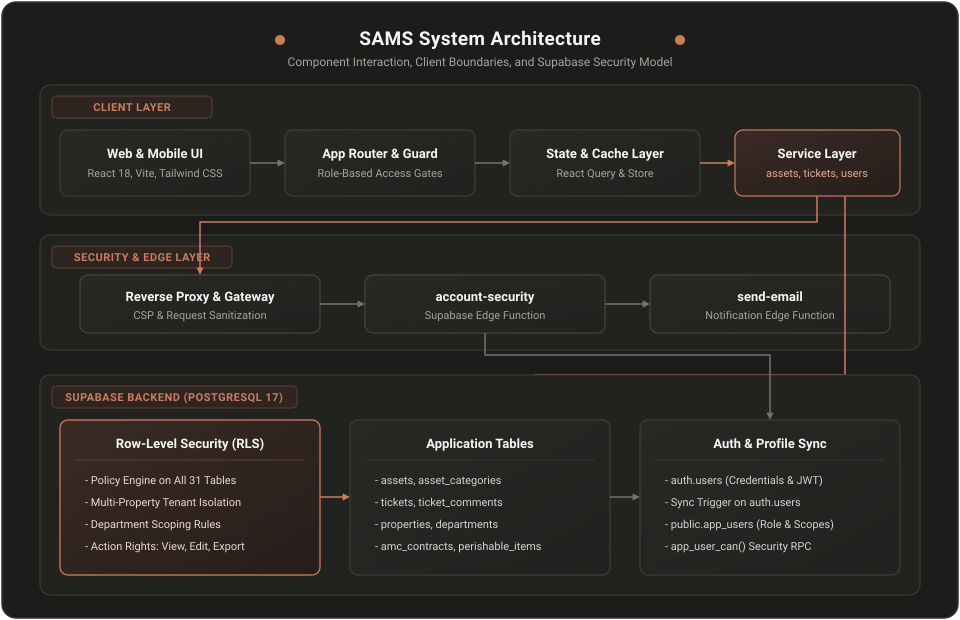
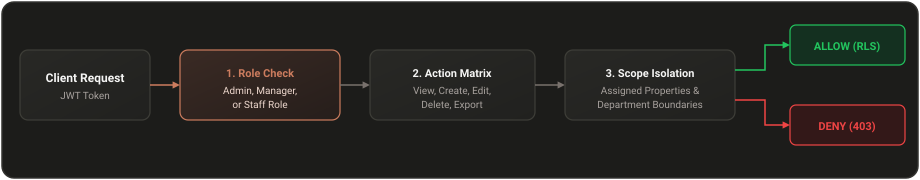

<div align="center">
  
  <p>A centralized enterprise platform for asset tracking, QR lifecycle operations, facility monitoring, and role-based maintenance.</p>
</div>

---

## Table of Contents

- [Overview](#overview)
- [System Architecture](#system-architecture)
- [Security Model and Access Control](#security-model-and-access-control)
- [Platform Modules](#platform-modules)
- [Prerequisites and Requirements](#prerequisites-and-requirements)
- [Step-by-Step Setup Guide](#step-by-step-setup-guide)
  - [1. Install Dependencies](#1-install-dependencies)
  - [2. Configure Environment Variables](#2-configure-environment-variables)
  - [3. Initialize the Supabase Database](#3-initialize-the-supabase-database)
  - [4. Create the Initial Administrator Account](#4-create-the-initial-administrator-account)
  - [5. Deploy Backend Edge Functions](#5-deploy-backend-edge-functions)
  - [6. Start the Development Server](#6-start-the-development-server)
- [How to Use SAMS](#how-to-use-sams)
- [Quality Assurance and Verification](#quality-assurance-and-verification)
- [Production Deployment](#production-deployment)
- [Quick Reference Summary](#quick-reference-summary)

---

## Overview

SAMS replaces scattered spreadsheets and manual paper logs with a single reliable system of record for fixed and operational assets. Built with React 18, TypeScript, Tailwind CSS, and Supabase PostgreSQL, it delivers fast search, bulk operations, QR code generation and printing, and maintenance ticket tracking across multi-location properties.

Key capabilities:
- Unified asset registry with quantity normalization, category tagging, and location tracking.
- Automated QR code labeling with single, batch, and print-sheet export (PDF, ZIP, PNG).
- Preventive maintenance tracking with Annual Maintenance Contract (AMC) renewal alerts.
- Food and perishable shelf-life tracking with expiry alerts.
- Service ticket flow with priority tracking, assignees, and resolution timelines.
- Strict multi-tenant security through PostgreSQL Row-Level Security (RLS) and granular action permissions.

---

## System Architecture

The following diagram illustrates how clients, frontend routers, API boundaries, and database services interact:

<p align="center">
  
</p>

---

## Security Model and Access Control

Security in SAMS is enforced directly at the database engine level, not merely in the user interface.

### 1. Authentication
- User identities and encrypted passwords reside entirely within the managed `auth.users` schema.
- Password hashes and authentication salts are never stored in or accessible through application tables.
- Sessions use JSON Web Tokens (JWT) issued and signed by Supabase Auth with automatic token rotation.

### 2. Authorization Hierarchy
Every authenticated request is checked against a three-dimensional permission model:

<p align="center">
  
</p>

- **Roles:**
  - **Administrator:** Full administrative rights across all properties, users, and security settings.
  - **Manager:** Operational management scoped to assigned properties. Cannot modify system security mappings or promote administrators.
  - **Staff:** Read and action access restricted to assigned properties, selected departments, and explicit action permissions.
- **Action Matrix:**
  - Permissions are broken down by module: View, Create, Edit, Delete, and Export.
  - View is the foundation. If View is disabled for a module, all other actions (Create, Edit, Delete, Export) are automatically denied.
  - Custom module keys (such as `stock_checks`) can be configured in the permission matrix and evaluated with `app_user_can(module_key, action)`.
- **Property and Department Scope:**
  - Non-admin users only access records belonging to their assigned properties.
  - Within an assigned property, access can be further narrowed to specific departments.
  - Records without an assigned property remain administrator-only until classified.

### 3. Database Row-Level Security (RLS)
- Every table in SAMS has Row-Level Security enabled with `FOR SELECT`, `FOR INSERT`, `FOR UPDATE`, and `FOR DELETE` policies.
- Direct table queries and remote procedure calls (RPCs) execute under the caller's verified JWT context.
- Update policies evaluate both the existing row and the proposed new row to prevent unauthorized re-assignment across properties.

### 4. Secret Isolation
- **Public configuration:** `VITE_SUPABASE_URL` and `VITE_SUPABASE_ANON_KEY` are safe for browser delivery because all requests are guarded by database RLS.
- **Private secrets:** `SUPABASE_SERVICE_ROLE_KEY`, `SUPABASE_DB_PASSWORD`, and `RESEND_API_KEY` must never be given a `VITE_` prefix and must never be committed to Git or exposed to the client.

---

## Platform Modules

| Module | Purpose | Key Capabilities |
| --- | --- | --- |
| Dashboard | Operational Overview | Real-time metrics, AMC watchlist, perishable expiry tracker, ticket velocity charts, recent activity feed |
| Assets | Inventory Registry | Search by name, ID, or serial; filter by type, property, and department; unit grouping; bulk CSV export |
| Asset Details | Lifecycle Inspection | Full metadata, location details, Straight-Line Depreciation (SLD) valuation, service ticket creation |
| Properties | Facility Registry | Multi-location management, assigned property managers, asset counts, status toggles |
| QR Codes | Label Production | Single and bulk QR generation, print sheets, customizable label dimensions, PNG/ZIP/PDF downloads |
| Scan QR | Field Audits | Non-invasive camera scanning, batch audit mode, manual image upload, automatic asset redirection |
| Tickets | Maintenance Workflows | Kanban board and list view, SLA tracking, priority tags, assignees, resolution timestamps |
| Users | Access Management | User directory, role assignment, property/department access assignment, 3-column permission matrix |
| Reports | Audit Documentation | Asset distribution, category breakdown, valuation summaries, printable audit reports |
| Settings | System Configuration | User profile, company information, notification preferences, system health telemetry |

---

## Prerequisites and Requirements

Ensure your workstation meets the following requirements:
- **Node.js:** Version 18.0.0 or higher.
- **npm:** Version 9.0.0 or higher.
- **Supabase Account:** A free or paid Supabase project (PostgreSQL 15+).
- **Git:** For source version control.
- **Optional for Edge Functions:** Supabase CLI and Deno installed locally.

---

## Step-by-Step Setup Guide

### 1. Install Dependencies

Clone the repository and install the locked dependencies:

```bash
git clone https://github.com/your-username/SAMS.git
cd SAMS
npm ci
```

### 2. Configure Environment Variables

Create your local environment configuration file from the template:

```bash
cp .env.example .env.local
```

Open `.env.local` in your editor and provide the credentials for your Supabase project:

```bash
# Browser Client Configuration (safe for public frontend)
VITE_SUPABASE_URL=https://your-project-id.supabase.co
VITE_SUPABASE_ANON_KEY=your-supabase-anon-key

# Server & Operator Secrets (never expose to frontend)
SUPABASE_SERVICE_ROLE_KEY=your-supabase-service-role-key
SUPABASE_DB_PASSWORD=your-database-password
RESEND_API_KEY=re_your_resend_api_key
```

### 3. Initialize the Supabase Database

1. Log in to the [Supabase Dashboard](https://supabase.com/dashboard).
2. Open your project and navigate to the **SQL Editor**.
3. Open the [`schema.sql`](schema.sql) file from the root of this repository.
4. Copy the entire contents of `schema.sql`, paste it into the Supabase SQL editor, and click **Run**.

What this step does:
- Creates all 31 application tables with proper foreign keys, constraints, and cascading rules.
- Installs Row-Level Security policies on all tables.
- Creates database triggers that synchronize Auth accounts with the `public.app_users` profile table.
- Configures real-time publication memberships.
- Sets up database helper functions including `app_user_can()` and permission checks.

Note: Run `schema.sql` only on a **fresh database**. The script is transactional and will safely abort if an existing SAMS schema is detected.

### 4. Create the Initial Administrator Account

Before signing in, create your administrator identity in Supabase Auth and map it to an application administrator profile:

1. In the Supabase Dashboard, go to **Authentication > Users** and click **Add User**.
2. Enter your email address and password, and check **Auto Confirm User**.
3. Return to the **SQL Editor** and run the following command (replace `you@example.com` with your exact email):

```sql
INSERT INTO public.app_users (id, name, email, role, status)
SELECT id, 'System Administrator', email, 'admin', 'Active'
FROM auth.users
WHERE lower(email) = lower('you@example.com')
  AND email_confirmed_at IS NOT NULL
ON CONFLICT (id) DO UPDATE
SET role = 'admin', status = 'Active';
```

4. Verify that one row was created in `public.app_users`.

### 5. Deploy Backend Edge Functions

To support secure user invitation, password resets, and email notifications:

```bash
# Log in to Supabase CLI
supabase login

# Link your local repository to your remote project
supabase link --project-ref your-project-id

# Deploy the account security function
supabase functions deploy account-security --no-verify-jwt=false

# Deploy the email notification function
supabase functions deploy send-email --no-verify-jwt=false

# Set runtime secret for email delivery
supabase secrets set RESEND_API_KEY=re_your_resend_api_key
```

### 6. Start the Development Server

Start Vite in local development mode:

```bash
npm run dev
```

Open your browser to `http://localhost:8000` and sign in with the administrator email and password you created in Step 4.

---

## How to Use SAMS

### Asset Lifecycle Management
1. Navigate to **Assets** and click **Add Asset**.
2. Fill in the asset name, category type, property location, department, quantity, purchase date, and optional serial number.
3. If the asset has an active warranty or maintenance agreement, toggle **Enable AMC Tracking** and specify the contract end date and vendor name.
4. If managing perishable food supplies, enter the batch expiration date to include it in the Food Expiry Tracker.
5. Save the record. The asset will immediately appear in the inventory table.

### Generating and Printing QR Codes
1. Select one or more assets in the Assets catalog using the checkboxes.
2. Click **Generate & Download QR Sheet** to open the export dialog.
3. Choose your print layout preset (e.g., standard Avery sheet, compact label roll, or custom grid).
4. Download the generated labels as a high-resolution PDF for printing, or export raw PNG codes packaged in a ZIP archive.
5. In the field, workers can open **Scan QR** from their mobile or tablet browser to scan any label and pull up the asset details instantaneously.

### Handling Maintenance Tickets
1. From an asset details page or from the **Tickets** module, click **Create Ticket**.
2. Select the property, asset, priority level (Low, Medium, High, Urgent), and describe the service issue.
3. Use the Kanban view to drag tickets through **Open**, **In Progress**, **Under Review**, and **Resolved** states.
4. Tickets automatically calculate resolution durations and feed into the Ticket Pulse velocity analytics.

### Managing Users and Roles
1. Navigate to **Users** (accessible to administrators only).
2. Click **Add User** to create an employee profile with their assigned role (Admin, Manager, Staff).
3. Use the **Property & Department Scope** section to assign which facilities the user is permitted to see.
4. Click **Edit Permissions** on any user to customize their granular action matrix (View, Create, Edit, Delete, Export) per module.

---

## Quality Assurance and Verification

The repository includes a suite of security and regression tests:

```bash
# Run unit and API security regression tests
npm test

# Type-check TypeScript across the entire application
npx tsc --noEmit

# Run ESLint across source files
npm run lint

# Build production bundle and check chunk sizes
npm run build
```

The automated tests in `tests/security/` verify:
- Unauthorized access rejection on private endpoints.
- Supabase proxy boundary isolation.
- Cache isolation and anti-pollution guarantees.
- Independence of View, Create, Edit, Delete, and Export permissions.
- Proper role boundaries preventing privilege escalation.

---

## Production Deployment

### Deploying to Vercel
1. Push your repository to GitHub, GitLab, or Bitbucket.
2. Import the project into the [Vercel Dashboard](https://vercel.com).
3. In Project Settings > Environment Variables, add:
   - `VITE_SUPABASE_URL`
   - `VITE_SUPABASE_ANON_KEY`
   - `SUPABASE_SERVICE_ROLE_KEY`
   - `RESEND_API_KEY`
4. The build command `npm run build` and output directory `dist` will be detected automatically via [`vercel.json`](vercel.json).
5. Deploy the application.

---

## Quick Reference Summary

- **Repository Root:** Single entry point for source code, schema, and configuration.
- **Frontend Framework:** React 18 with TypeScript, Vite, Tailwind CSS, and Radix UI primitives.
- **Database Schema:** Single unified database definition located at [`schema.sql`](schema.sql).
- **Security Standard:** Database-level PostgreSQL Row-Level Security, JWT validation, and scoped permission matrices.
- **Port and Local URL:** Starts on port `8000` via `npm run dev`.
